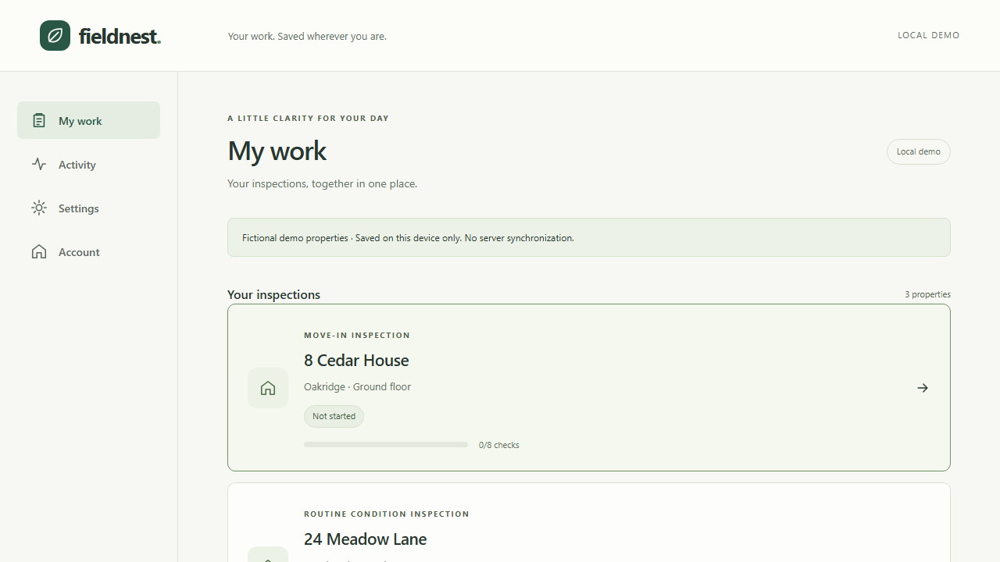
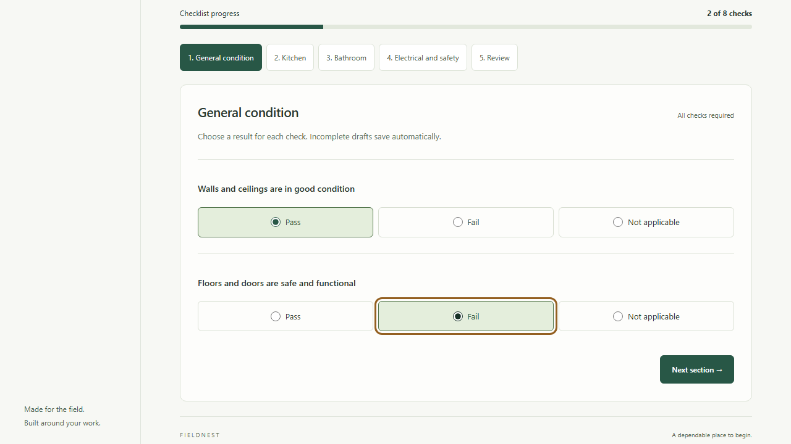
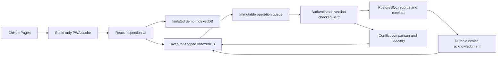

# Fieldnest

**Your work. Saved wherever you are.**

Fieldnest helps property inspectors finish their checklist when the connection is unreliable. Answers save on the device first. Connected accounts synchronize later, with version checks that preserve competing edits instead of silently overwriting them.

[Try the live app](https://abbasikhadija.github.io/fieldnest/) · [Architecture](docs/ARCHITECTURE.md) · [Failure demos](docs/DEMO_GUIDE.md) · [Release checks](docs/RELEASE.md)

## Try it in two minutes

1. Choose **Try Fieldnest**. No account or setup is required.
2. Open a fictional property and answer a few checks. Wait for **Saved on this device**.
3. Refresh to recover your draft. Once the app is cached, disconnect and continue working.
4. Review the checklist, follow missing-answer links, and complete it when every check is answered. Completed inspections are locked review copies.

Demo records stay on this device and never synchronize to a server. **Account** opens the separate connected workspace for privately provisioned users; no public shared login is provided.



## What works

- Eight predefined property checks, optional observations, incomplete drafts and completion.
- Acknowledged device saves, refresh recovery, offline routes and JSON recovery downloads.
- Supabase password sign-in, authorized assignments and isolated account/project caches.
- Durable synchronization with stable request IDs, bounded retries and atomic acknowledgment cleanup.
- Side-by-side conflict review, explicit device/server choices and retained recovery history.
- Mobile layouts, keyboard section navigation and automated accessibility checks.



## How synchronization protects work

A device save commits the record and an immutable queued request together. The server authenticates the request, verifies assignment and checks its base version inside a PostgreSQL transaction. It saves the updated record and a receipt together. If a response disappears, the device retries the **same request ID** and receives the original result without applying the change twice.

A stale base version produces a conflict. The device keeps its edits and the server snapshot. The inspector reviews differences and either adopts the reviewed server copy or queues a fresh request against that reviewed version. Another writer can still win first; that produces another review, never an unconditional overwrite. Completed server inspections cannot be replaced.



The frontend is hosted on GitHub Pages under `/fieldnest/`; Supabase hosts Auth and PostgreSQL. Hash routing supports direct links without server rewrites. Service-worker caching is limited to application assets, never authenticated API responses. [Detailed protocol](docs/SYNC_PROTOCOL.md).

## Run locally

Use Node.js 22.12 or newer in the Node 22 release line.

```sh
npm ci
npm run dev
```

Open http://127.0.0.1:5173/fieldnest/. The local demo needs no backend. For connected accounts, follow [backend setup](docs/BACKEND_SETUP.md); use only the Supabase URL and browser-safe publishable/anon key in `.env.local`. Never put secret or service-role keys in `VITE_` variables. Do not reset the configured hosted project or replay its foundation migrations.

## Verify and reproduce failures

```sh
npm run typecheck
npm run lint
npm test
npm run test:db
npm run build
npm run security:check
npx playwright install chromium firefox webkit
npm run test:e2e
npm run test:release
```

Native database tests require installed PostgreSQL. Connected integration tests require a disposable local Supabase/Docker stack and private generated fixtures; see [setup](docs/BACKEND_SETUP.md) and [failure demonstrations](docs/DEMO_GUIDE.md). Do not point fixture scripts or test bootstrap SQL at production.

CI gates deployment on the standard suite, real PostgreSQL and actual Supabase/Auth/connected-browser tests. A separate smoke job verifies the deployed Git SHA, assets, manifest, icons and service worker. Run `npm run smoke:production` to inspect the public deployment. `FIELDNEST_BASE_URL` runs browser checks against the deployed origin.

## Engineering evidence and limits

[UX measurements](docs/UX_REVIEW.md) document actual before/after results: synthetic idle queue selection improved from 150.9ms to 1.8ms median on the reference host; initial JavaScript became smaller. Timings are workload/device-specific. [Security review](docs/SECURITY_REVIEW.md) describes the checked boundaries and remaining risks.

Only successfully acknowledged device writes survive refresh. A crash can lose unsaved memory; browser deletion/eviction, private browsing and device loss can remove local data. Persistent-storage requests and exit warnings are best effort. JSON exports have no in-app import. Signing out hides account data and retains saved work; browser storage is not encryption. Synchronization while the browser is closed is not promised.

Automated emulation and Chromium installability diagnostics are distinct from physical-device testing and an actual OS-level PWA installation. Those manual checks, screen-reader evaluation and private hosted second-device testing are tracked in [release status](docs/RELEASE.md).
