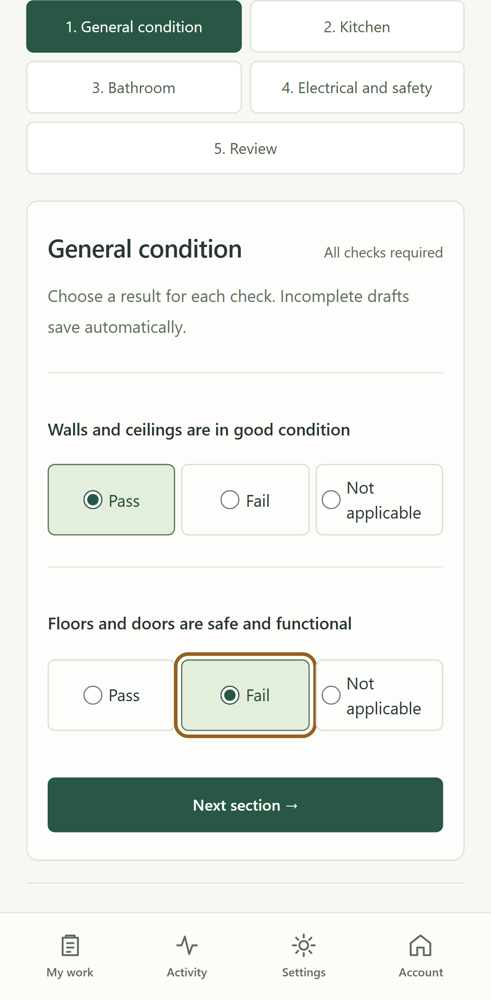

# Demonstrating Fieldnest

## Public offline workflow

Open https://abbasikhadija.github.io/fieldnest/, choose Try Fieldnest and open a fictional property. Answer one check and wait for Saved on this device. Reload: the answer remains. Wait for offline caching, disconnect, answer more checks and reload again. Reconnect when finished. No demo record is sent to the server.

Answer all eight checks, review observations and choose Complete inspection to lock a result. Use a different unfinished property for further editing. Download a copy for a backup; do not clear site data to demonstrate recovery.

## Connected conflicts and failed submissions

Use a **disposable loopback Supabase stack**, never the hosted project, for deliberate failure injection. With Docker available, follow BACKEND_SETUP.md and run:

```powershell
npx supabase start
npm run test:auth
npm run seed:local
npm run build:local
npx playwright install chromium
npm run test:e2e:auth
```

Local credentials remain in ignored .local/accounts.json. Never publish them, use them as production accounts or include Auth tokens/passwords in recordings. The connected suite creates/deletes its own fictional assignments.

| Scenario | What to observe |
| --- | --- |
| Both authorized clients edit offline | A succeeds; B's stale request preserves both copies and opens comparison |
| B chooses its copy | A fresh request checks the reviewed server version; both clients can retrieve the result |
| Server changes during review | B gets another conflict, not an unconditional overwrite |
| Responses lost after commit repeatedly | One request ID replays one server effect, including after reload and two tabs |
| Device acknowledgment save fails | Success remains unconfirmed; the same request safely confirms its receipt later |
| Server copy chosen | Reviewed server values are adopted; device edits remain in downloadable history |

Run selected cases with `npx playwright test --config playwright.connected.config.ts reliability.spec.ts` or `npx playwright test --config playwright.connected.config.ts conflicts.spec.ts`. Both require the disposable backend and local build.

For a manual walkthrough, privately sign in as the two generated local users in separate browsers, open their shared draft, disconnect both and make different answers. Reconnect/sync A, then B. Review both snapshots in B, choose a copy and refresh A. Sync saved work brings scheduled retries forward; it does not steal active leases or restart conflicts.

## Installation and physical mobile validation

Open the live URL online in a supported browser and use its Install/Add to Home Screen action. Launch the installed app, save a fictional draft, disconnect and reopen it. Record OS, browser/version, date and observed result in RELEASE.md. A manifest/eligibility diagnostic does not prove OS-level installation. Private modes may not offer installation.

The automated release suite exercises Chromium, Firefox and iPhone-emulated WebKit. It does not claim a real iPhone/Safari installation or physical-device coverage. Keep these manual results separate from automated evidence.


